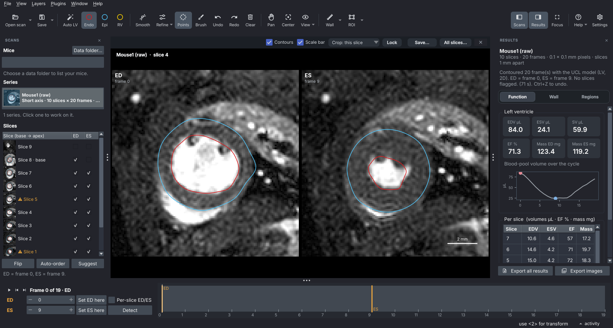

<p align="center">
  <picture>
    <source media="(prefers-color-scheme: dark)" srcset="docs/assets/tracecmr-logo-dark.svg">
    
  </picture>
</p>

# TraceCMR

A free, open-source desktop app for measuring the **left ventricle in mouse cine MRI**. Open a scan straight
from the scanner, let Auto LV draw a first draft of the contours, check and correct them slice by slice, and get
EDV, ESV, stroke volume, EF, LV mass and regional wall thickness, ready to export. Everything runs on your own
computer; scans are never uploaded.

<p align="center">
  
  <br><sub>A mouse from UCL's open dataset, contoured by Auto LV on every frame, with ED and ES found from the volume curve.</sub>
</p>

> **Beta (v0.3.5).** Used so far on UCL's open dataset and on a first Bruker scan from an outside facility.
> The numbers are only as good as the contours: look at every slice before you trust a result. Not yet
> validated for publication-grade research; we'd love to hear how it does on your scans.

## Download

**[Latest release](https://github.com/jairam09/TraceCMR/releases/latest)**: `TraceCMR-Windows.exe` (Windows 10/11)
or `TraceCMR-macOS.pkg` (Mac with Apple silicon). No Python or other setup needed, and Auto LV works straight
away. The installers aren't code-signed yet, so the first open shows a warning: on Windows click **More info →
Run anyway**; on a Mac, right-click the file → **Open** (or System Settings → Privacy & Security → **Open Anyway**).

TraceCMR keeps itself up to date: when a new version is out it offers it at start (or Help → Check for updates)
and installs it on restart, going back to the previous version by itself if anything fails
([docs/updates.md](docs/updates.md)).

## What it does

| | |
| --- | --- |
| **Opens** | Bruker ParaVision study folders directly (`2dseq` + `visu_pars`, no export needed); DICOM cines, classic and enhanced multi-frame, including Bruker's export; NIfTI; UCL's open dataset (.h5). Short-axis scans saved one slice per series are stacked in slice order from their positions. |
| **Contours** | Auto LV (UCL's published mouse model, built in) on one frame or every frame; drag-point editing, brush, smoothing, undo; ED and ES per slice or for the whole stack, picked by hand or found from the volume curve. |
| **Checks** | Flags slices to review (wall in pieces, blood pool without a wall, sudden jumps between slices, the base and apex), suggests which slices to include at ED and ES, and warns about slice order. |
| **Measures** | EDV, ESV, SV, EF, LV mass at ED and ES, per slice and in total; regional end-diastolic wall thickness and systolic thickening with bullseye plots; ROIs. |
| **Exports** | One spreadsheet per mouse plus a study summary, figures (ED \| ES side by side, all slices), and a contour file that reopens exactly as you left it. |
| **Planned** | LGE scar size and transmurality; following the same mouse across scans; Segment (.mat) input. |

## How good is Auto LV?

Auto LV runs the model published by Shah, Stuckey, Steeden et al.
([J Cardiovasc Magn Reson 2026](https://github.com/mrphys/Open-Source_Pre-Clinical_Segmentation)), trained on
UCL's 9.4 T mouse cines. On UCL's 25 held-out test mice, contoured by the app at the expert's ED and ES frames and
compared with the expert's contours:

| | Auto LV minus expert, mean (SD) |
| --- | --- |
| EF | −1.1 (3.0) percentage points; worst mouse off by 7.3 |
| EF, fully automatic (every frame contoured, ED and ES found by the app) | +0.3 (3.2) points; worst off by 6.8 |
| EDV | −2.4 (6.3) µL |
| LV mass | +1.7 (13.6) mg |
| Overlap with the expert (Dice), ED / ES | blood pool 0.91 / 0.87, myocardium 0.85 / 0.88 |

That is the best case: the model's own lab, scanner and protocol. On scans from other scanners it can be clearly
worse. On the first outside scan we tried (an infarcted mouse, Bruker cine after a contrast injection), it worked
well on the non-infarcted slices and failed on the infarcted ones, where the enhanced scar looks like blood to a
model trained on non-contrast cines. Treat Auto LV as a first draft that saves clicks, not as the answer: every contour can be edited, and flagged slices are
marked in the slice list. Details: [docs/models.md](docs/models.md).

## Feedback

Questions, bug reports and scans that go wrong are all welcome: open a
[GitHub issue](https://github.com/jairam09/TraceCMR/issues) or email jaikrishnanram10908@gmail.com. If you can share
an anonymised scan that TraceCMR reads badly, that helps most.

## Credits and citing

Auto LV is the UCL team's published model, and TraceCMR was tested on their open mouse dataset. If you use Auto
LV, please cite their paper:

> Shah W, Stuckey DJ, Yao T, Wrobel M, Deniszczyc E, Feng Z, Anderson S, Campbell R, Muthurangu V, Steeden J.
> Open-source pre-clinical image segmentation: mouse cardiac magnetic resonance imaging datasets with a deep
> learning segmentation framework. *J Cardiovasc Magn Reson* 2026;28(1):102706.
> [doi:10.1016/j.jocmr.2026.102706](https://doi.org/10.1016/j.jocmr.2026.102706)
> ([code, data and model](https://github.com/mrphys/Open-Source_Pre-Clinical_Segmentation))

The app shows this under Help → About TraceCMR and credits, names the model next to Auto LV, and writes the reference
into every exported results file. GitHub's "Cite this repository" ([CITATION.cff](CITATION.cff)) lists it too.
Their model ships with TraceCMR as a separate file under their licence (GPL-3.0); see
[docs/datasets.md](docs/datasets.md).

## For developers

```bash
git clone https://github.com/jairam09/TraceCMR.git
cd TraceCMR
pip install -e ".[dev,app,auto]"   # "auto" = ONNX Runtime for Auto LV
pytest
tracecmr                            # the app
```

From source, the first click on Auto LV downloads the model (about 19 MB, checked against its pinned SHA-256).
Analysis without the app:

```bash
python scripts/check_dataset.py --phantom --out data/checks                         # synthetic heart
python scripts/check_dataset.py --ucl data/ucl/Data/Mouse1.h5 --frame ED --out data/checks
python scripts/check_dataset.py --dicom path/to/series --out data/checks
python scripts/run_volumes.py --ucl-dir data/ucl/Data --out results/ucl_volumes.csv  # EDV, ESV, SV, EF, mass
python scripts/run_wall.py --ucl-dir data/ucl/Data --out results/wall                # wall thickness, bullseyes
```

`check_dataset.py` prints shape, voxel spacing, label volumes and warnings, and saves an overlay PNG: open it and
look at every slice before trusting a number. In Python:

```python
from tracecmr import load_nifti, sanity_check
ci = load_nifti("image.nii.gz", "label.nii.gz", label_map="acdc")
print(ci.spacing, ci.labels_present())
print(sanity_check(ci, species="human"))
```

**Conventions.** Every format is translated on load into one label scheme (`src/tracecmr/labels.py`):
0 background, 1 LV blood pool, 2 LV myocardium, 3 RV blood pool, 4 scar, 5 MVO. Arrays are `(x, y, slice)`
(plus frame); spacing in mm, volumes in µL (1 mm³ = 1 µL). Results record the papillary-muscle convention of the
contours (UCL counts them as myocardium), and the pipeline refuses to compare results across conventions.
Methods and validation: [docs/methods.md](docs/methods.md); development log:
[docs/lab_notebook.md](docs/lab_notebook.md).

**Data.** No data is stored in this repository; see [docs/datasets.md](docs/datasets.md) for the public datasets
used in development, their licences and how to cite them. Contributions: [CONTRIBUTING.md](CONTRIBUTING.md).

## AI assistance

Parts of this project were developed with AI assistance. See [docs/ai_usage.md](docs/ai_usage.md).

## Licence

TraceCMR is MIT-licensed ([LICENSE](LICENSE)). The installers also include UCL's model as a separate file under
GPL-3.0 (above). The app bundles the [Inter](https://github.com/rsms/inter) typeface (Regular and Bold),
© The Inter Project Authors, under the SIL Open Font License 1.1
([src/tracecmr/app/resources/fonts/OFL.txt](src/tracecmr/app/resources/fonts/OFL.txt)).
